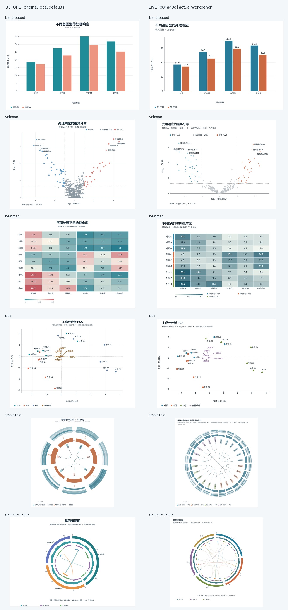

# 55 模板期刊绘图质量更新：正式站验收

2026-09-08 17:14（北京时间）正式站已切换到 `b04a48cb71e8e14417e6027651d2c8c286c74cfc`。本次将此前完成的 55 模板视觉改造与统计示例修复上线，保留可编辑数据、样式、图层、布局和分析结果。

[参考论文、具体图号、逐模板差距与设计方案](../design/journal-figure-quality.md)保持独立于本次上线验收。该清单收录 21 条文献线索，其中 15 条已看图；其余方法、候选或反例状态按原清单标注，不能算作全部已核实的优质视觉实例。图形由 OpenAcad 实际渲染，不用论文图片或静态图片代替工作台。新增示例均标明模拟性质。

## 本次实际结果

- **55/55 模板**完成正式工作台默认图、替代数据、项目保存重开与 220 份 SVG/PNG/PDF/EPS 下载。55 个默认项目的数据、样式和图层与本地已验收项目逐字段一致；没有页面错误、非有限坐标或文字超出画布。5 种排序模板的替代数据实际调用正式统计服务。
- **55/55 卡片、详情、工作台**在归一化图形 ID 后 SVG 结构哈希一致。正式站的[原始操作记录](../deployment/evidence/1.1.0-b04a48c/template-operations.json)与[三处显示对照](../deployment/evidence/1.1.0-b04a48c/surface-consistency.json)分别保存。
- **23 项跨浏览器专项通过、41 项按配置跳过、0 失败/不稳定**，包含 5 种真实排序、桌面/手机各四格式宋体下载、四浏览器离线字体、替代推断示例与字体/取消专项。受控异常注入不充当真实统计计算通过。[原始浏览器结果](../deployment/evidence/1.1.0-b04a48c/browser-results.json)。
- **5 项生产 API 数值/导出验证通过**：PCA 重构最大绝对误差 `5.329e-15`；R LM 与独立最小二乘系数在 `1e-10` 内一致；PNG 解码、PDF 经 Poppler、EPS 经 Ghostscript 独立打开通过。任务未重试 POST，已清理本次临时任务。[完整报告](../deployment/evidence/1.1.0-b04a48c/api-smoke.json)。
- **4 个旧项目各两轮保存重开通过**，数据、样式、图层、布局和分析五字段完全相同。首轮验收脚本误选了临时 SVG 测量副本，改用工作台直接 SVG 后通过；没有因此修改应用。[旧项目结果](../deployment/evidence/1.1.0-b04a48c/legacy-projects.json)。

发布前的 275 场景覆盖 55 模板默认、替代、小画布、宽画布、长标签与分组变化；发布评审修复后另对四种推断模板补跑 20 场景。本次生产默认/替代为 **110 场景**，没有把发布前压力场景改称生产全量压力验收。火山和三种富集图的主/替代数据均保存原始模拟依据，分别真实计算 Welch 检验、超几何上尾与 BH 校正；评审指出的旧替代示例方法不一致问题已修复并验收。

## 改造前后与实际大图

下图左侧为本轮改造前的本地默认，右侧为正式工作台。两侧是模拟示例，不能作为同一实验结果的科学比较。分组柱状图增强数值层次和分组配色；火山图标注真实检验与未校正 P；热图区分数值色阶和处理注释；排序图用颜色与点形共同区分组；树图与基因组图增加合理密度并保留比例、轨道说明。

查看正式大图：[分组柱状](../deployment/evidence/1.1.0-b04a48c/live-bar-grouped.png)、[火山](../deployment/evidence/1.1.0-b04a48c/live-volcano.png)、[热图](../deployment/evidence/1.1.0-b04a48c/live-heatmap.png)、[PCA](../deployment/evidence/1.1.0-b04a48c/live-pca.png)、[环形树](../deployment/evidence/1.1.0-b04a48c/live-tree-circle.png)、[基因组圈图](../deployment/evidence/1.1.0-b04a48c/live-genome-circos.png)。[55 图总览](../deployment/evidence/1.1.0-b04a48c/all55-live.jpg)供快速定位，不替代大图与实际文件检查。

## 独立打开与差异

55 SVG 在离线浏览器中真实加载其内嵌字体；165 PNG/PDF/EPS 经 Pillow/Ghostscript 打开，与同一导出 SVG 栅格比较。最大归一化平均通道差 `0.00697`，模糊后为 `0.00470`。颜色抗锯齿及 EPS 页面取整造成小差异，不能写成四格式逐像素完全相同。[逐图度量](../deployment/evidence/1.1.0-b04a48c/independent-export-comparison.json)、[55 SVG 离线字体](../deployment/evidence/1.1.0-b04a48c/svg-offline-open.json)、[220 文件 SHA](../deployment/evidence/1.1.0-b04a48c/export-files.json)。复查了最大差异的基因簇 EPS、环形树 EPS，以及火山 PDF、热图 PDF 的大图，文字、数值、方向和图层完整。

额外 8 份桌面/手机宋体下载全部独立打开，SVG 转曲、PNG 150 DPI、PDF/EPS 尺寸一致；两 PDF 均嵌入真实 Noto Serif Regular/Bold。[宋体验证](../deployment/evidence/1.1.0-b04a48c/serif-independent-open.json)。

50/55 正式默认 PNG 与本地已验收文件像素完全一致。其余四项平均通道差低于 `0.00018/255`；UpSet 为 `0.39823/255`，主要是四行集合名称的文字基线。UpSet 两份 SVG 的完整字节与全部 153 元素相同，柱高、成员关系与数值未变，各行名称仍清楚对应；具体渲染原因尚未单独定位。[差异与核查原文](../deployment/evidence/1.1.0-b04a48c/upset-pixel-investigation.json)。没有把这项差异改写成像素完全一致。

EPS 透明效果可包含栅格；本次不是所有 DPI、透明度、任意外部数据和所有矢量编辑器组合的穷尽验证。KEGG 本次只复核服务健康，没有将其当作上游查询通过。没有强制进行生产回退再升级，保留上一发行及镜像，13 项恢复回归通过。

## 逐模板验收索引

每行均为默认与替代数据 2 场景、五字段项目往返、4 格式实际下载及独立打开通过。末列是 SVG 与其余三个格式的最大模糊后归一化像素差，仅辅助定位视觉差异，不验证统计推断。

| 模板 | 场景 | 下载 | 最大差异 |
| --- | ---: | ---: | ---: |
| [散点图](https://openacad.xyz/#template/scatter) | 2 | 4 | 0.00122 |
| [分组柱状图](https://openacad.xyz/#template/bar-grouped) | 2 | 4 | 0.00175 |
| [折线图与分组折线图](https://openacad.xyz/#template/line) | 2 | 4 | 0.00161 |
| [数值热图](https://openacad.xyz/#template/heatmap) | 2 | 4 | 0.00338 |
| [箱线图](https://openacad.xyz/#template/box) | 2 | 4 | 0.00188 |
| [饼图与环图](https://openacad.xyz/#template/pie) | 2 | 4 | 0.00144 |
| [柱状图](https://openacad.xyz/#template/bar) | 2 | 4 | 0.00143 |
| [分类柱状图](https://openacad.xyz/#template/bar-category) | 2 | 4 | 0.00211 |
| [误差柱状图](https://openacad.xyz/#template/bar-error) | 2 | 4 | 0.00211 |
| [分组误差柱状图](https://openacad.xyz/#template/bar-grouped-error) | 2 | 4 | 0.00237 |
| [散点误差图](https://openacad.xyz/#template/scatter-error) | 2 | 4 | 0.00166 |
| [堆叠柱状图](https://openacad.xyz/#template/bar-stacked) | 2 | 4 | 0.00187 |
| [分组堆叠柱状图](https://openacad.xyz/#template/bar-grouped-stacked) | 2 | 4 | 0.00264 |
| [柱状图与折线组合](https://openacad.xyz/#template/bar-line) | 2 | 4 | 0.00157 |
| [棒棒糖图](https://openacad.xyz/#template/lollipop) | 2 | 4 | 0.00149 |
| [分类棒棒糖图](https://openacad.xyz/#template/lollipop-category) | 2 | 4 | 0.00214 |
| [分组误差折线图](https://openacad.xyz/#template/line-error) | 2 | 4 | 0.00171 |
| [分组箱线图](https://openacad.xyz/#template/box-grouped) | 2 | 4 | 0.00193 |
| [小提琴图](https://openacad.xyz/#template/violin) | 2 | 4 | 0.00184 |
| [云雨图](https://openacad.xyz/#template/raincloud) | 2 | 4 | 0.00177 |
| [峰峦图](https://openacad.xyz/#template/ridgeline) | 2 | 4 | 0.00194 |
| [UpSet 集合交集图](https://openacad.xyz/#template/upset) | 2 | 4 | 0.00194 |
| [玫瑰图](https://openacad.xyz/#template/rose) | 2 | 4 | 0.00186 |
| [雷达图](https://openacad.xyz/#template/radar) | 2 | 4 | 0.00245 |
| [分组散点图](https://openacad.xyz/#template/scatter-grouped) | 2 | 4 | 0.00119 |
| [哑铃图](https://openacad.xyz/#template/dumbbell) | 2 | 4 | 0.00193 |
| [圈形热图](https://openacad.xyz/#template/circle-heatmap) | 2 | 4 | 0.00241 |
| [圆点二值图](https://openacad.xyz/#template/binary-dot) | 2 | 4 | 0.00207 |
| [方格二值图](https://openacad.xyz/#template/binary-rect) | 2 | 4 | 0.00264 |
| [数值气泡矩阵](https://openacad.xyz/#template/bubble-matrix) | 2 | 4 | 0.00276 |
| [组内相关性热图](https://openacad.xyz/#template/correlation) | 2 | 4 | 0.00141 |
| [组间相关性热图](https://openacad.xyz/#template/double-correlation) | 2 | 4 | 0.00167 |
| [Mantel 关联热图](https://openacad.xyz/#template/mantel) | 2 | 4 | 0.00202 |
| [韦恩集合交集图](https://openacad.xyz/#template/venn) | 2 | 4 | 0.00207 |
| [分组圆堆砌图](https://openacad.xyz/#template/packing) | 2 | 4 | 0.00202 |
| [桑基流向图](https://openacad.xyz/#template/sankey) | 2 | 4 | 0.00233 |
| [动态关系网络图](https://openacad.xyz/#template/network) | 2 | 4 | 0.00282 |
| [地理采样点地图](https://openacad.xyz/#template/map) | 2 | 4 | 0.00333 |
| [差异表达火山图](https://openacad.xyz/#template/volcano) | 2 | 4 | 0.00253 |
| [富集气泡图](https://openacad.xyz/#template/enrichment-dot) | 2 | 4 | 0.00168 |
| [富集条形图](https://openacad.xyz/#template/enrichment-bar) | 2 | 4 | 0.00172 |
| [富集圈图](https://openacad.xyz/#template/enrichment-circle) | 2 | 4 | 0.00283 |
| [基因簇排列图](https://openacad.xyz/#template/gene-cluster) | 2 | 4 | 0.00470 |
| [蛋白保守结构域图](https://openacad.xyz/#template/protein-domains) | 2 | 4 | 0.00229 |
| [蛋白保守基序图](https://openacad.xyz/#template/protein-motifs) | 2 | 4 | 0.00287 |
| [基因组圈图](https://openacad.xyz/#template/genome-circos) | 2 | 4 | 0.00250 |
| [MCScanX 共线性图](https://openacad.xyz/#template/synteny) | 2 | 4 | 0.00186 |
| [主成分分析 PCA](https://openacad.xyz/#template/pca) | 2 | 4 | 0.00203 |
| [主坐标分析 PCoA](https://openacad.xyz/#template/pcoa) | 2 | 4 | 0.00180 |
| [非度量多维尺度 NMDS](https://openacad.xyz/#template/nmds) | 2 | 4 | 0.00199 |
| [典范对应分析 CCA](https://openacad.xyz/#template/cca) | 2 | 4 | 0.00202 |
| [冗余分析 RDA](https://openacad.xyz/#template/rda) | 2 | 4 | 0.00196 |
| [矩形进化树工作台](https://openacad.xyz/#template/tree-normal) | 2 | 4 | 0.00263 |
| [环形进化树工作台](https://openacad.xyz/#template/tree-circle) | 2 | 4 | 0.00365 |
| [无根进化树工作台](https://openacad.xyz/#template/tree-unrooted) | 2 | 4 | 0.00190 |
